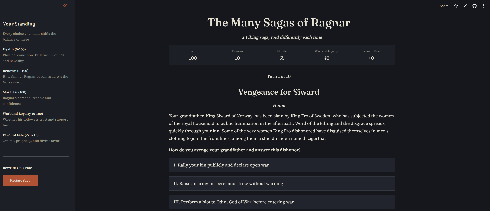

# The Many Sagas of Ragnar
A 10-turn interactive game where you play as Ragnar Lothbrok, legendary king and raider. Python controls the game state and outcomes, while an LLM grounded in a Norse knowledge base through retrieval-augmented generation (RAG) narrates the story differently each time.

🎮 **Play it live: [many-sagas-of-ragnar.streamlit.app](https://many-sagas-of-ragnar.streamlit.app)**

> ⏳ **Cold start:** the app sleeps when idle, so the first visit may take a few minutes to load. You may see "This app has gone to sleep due to inactivity. Would you like to wake it back up?" If so, click "Yes, get this app back up!" and wait while it wakes up. Once it's running, the game responds normally.



## Stack
| Component | Role |
|---|---|
| **Streamlit** | UI and deployment (Streamlit Community Cloud) |
| **LangChain** | Orchestration: retrieval, prompt templates, LLM calls |
| **Chroma** | Vector database |
| **Hugging Face (all-MiniLM-L6-v2)** | Embedding model |
| **Groq (openai/gpt-oss-120b)** | LLM inference |


## Architecture
| Layer | Responsibility | Where |
|---|---|---|
| **Python game engine** | Manages story nodes, choices, stat changes, and turn tracking | `game/` |
| **RAG** | Finds relevant Norse lore for the moment in the story | `rag/` |
| **LangChain + Groq LLM** | Retrieves lore, fills prompt templates, and narrates the outcome | `rag/`, `orchestrator.py` |
| **Streamlit UI** | Renders the stats glossary, stats header, narrative panel, choice buttons, and error handling | `app.py`, `theme.py` |

### The turn loop

```
Fixed context shown to player
        │  player picks a choice
        ▼
Python applies the choice's stat changes (deterministic)
        │
        ▼
Retrieval query = choice outcome + next turn's context
        │
        ▼
Chroma returns the top 3 most relevant lore chunks
        │
        ▼
Prompt = current context + choice + author-written outcome
         + next context + retrieved lore
        │
        ▼
Groq LLM narrates what happened, leading into the next turn
```

### Fixed context, LLM-generated transitions
Each turn's context and question are author-written and never touched by the LLM. Each choice also carries an author-written outcome, a short beat describing what actually happens. The LLM expands that beat and leads it into the next turn's context.

This matters because choices can diverge from what the next turn assumes. For example, a player can accept a political marriage with Ingibjorg in Turn 5, yet Turn 6 still opens with Aslaug bearing sons. Rather than letting the model improvise a bridge, the outcome supplies the reconciling beat and the retrieved lore keeps the transition consistent with the source material.


## Knowledge Base
The corpus is 21 Wikipedia articles under the [Creative Commons Attribution-ShareAlike 4.0 license](https://creativecommons.org/licenses/by-sa/4.0/). It is split into two categories:

- **Saga and history:** Ragnar Lodbrok, *Tale of Ragnar Lodbrok*, Lagertha, Þóra Borgarhjǫrtr, Aslaug, Björn Ironside, Ivar the Boneless, Sigurd Snake-in-the-Eye, the Siege of Paris (845), early Scandinavian Dublin, Ælla of Northumbria, and the Great Heathen Army
- **Norse mythology and culture:** Old Norse religion, Valhalla, Odin, seeresses (völur), Norse rituals, blót, Norse funerals, Viking Age arms and armour, and longships


## Known Limitations
- **One source story, many branches:** The sagas record a single version of events, but the game offers three choices per turn. The corpus has no concept of those branches, so retrieval can surface a detail that contradicts the choice the player just made. The written outcome and prompt constraints reduce this contradiction
- **Wikipedia as the source:** The corpus is Wikipedia text, a secondary source, rather than primary saga translations
- **Free-tier rate limits:** The app runs on Groq's free tier. If the limit is hit, the player sees the message "The skalds falter in their telling of this tale..." and can retry once or skip that turn's narration
- **Cold starts:** Idle apps sleep and waking one takes a few minutes


## Getting Started
**Prerequisites:** Python 3.11+ and a free Groq API key.

```bash
# Clone the repo and cd into it
git clone https://github.com/jdu-ml/many-sagas-of-ragnar.git
cd many-sagas-of-ragnar

# Create and activate a virtual environment
python -m venv .venv
source .venv/bin/activate        # Windows: .venv\Scripts\activate

# Install dependencies
pip install -r requirements.txt

# Add your Groq API key
cp .env.example .env             # then edit .env and set GROQ_API_KEY

# Run the app
streamlit run app.py
```

The repository includes the pre-built `chroma_db/`, so the game runs immediately.


## Repo Structure
```
many-sagas-of-ragnar/
├── app.py               # Streamlit UI
├── theme.py             # Custom theme and styling
├── orchestrator.py      # Turn pipeline linking story, retrieval, prompt, and LLM
├── game/
│   ├── story.py         # Story arc (contexts, choices, outcomes, stat changes)
│   ├── state.py         # Player stats and game state
│   ├── mechanics.py     # Stat changes and ending checks
│   └── engine.py        # Game engine
├── rag/
│   ├── ingestion.py     # Cleaning and chunking
│   ├── embeddings.py    # Embedding model and Chroma build
│   ├── retriever.py     # Similarity search over Chroma
│   ├── prompts.py       # Retrieval query and narration prompt templates
│   └── llm.py           # Groq client and error handling
├── data/
│   ├── fetch_sources.py # Wikipedia article download
│   ├── raw/             # Source articles (JSON)
│   └── processed/       # Chunked corpus
├── chroma_db/           # Pre-built vector database
├── assets/              # README screenshots
└── requirements.txt
```


## Future Opportunities
- Additional story branches and longer adventures
- Early endings, such as a warband mutiny when loyalty collapses
- An expanded Norse corpus that includes primary-source saga translations
- A remote vector database, if the corpus outgrows the pre-built local one
